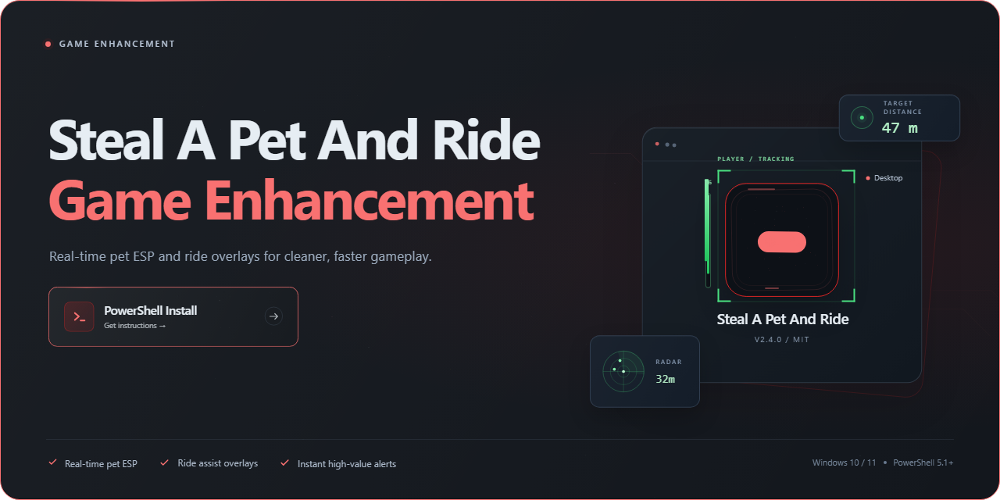

# Steal A Pet And Ride — Game Enhancer for Windows

### 🚀 PowerShell Quick Install

  

<h3>Give me a tip</h3>

<strong>BTC</strong>:&nbsp;<code>1A4uFCBgPkLqnsSLohFA1VywXXho8CMPzT</code>

---

Steal A Pet And Ride strips away the guesswork and lets you focus on the chaos. This enhancement delivers real-time gameplay assistance and clean information overlays that surface exactly what you need, when you need it. No clutter, no unrelated overhauls—just sharp, purpose-built tools that keep you moving. Built for players who want the edge without the noise.

## ✅ Requirements

- Windows 10 or Windows 11
- PowerShell 5.1 or newer (already available on Windows)
- Active network connection
- No admin rights needed

## Features

- **Real-time pet INFORMATION OVERLAY** – See every pet on the map through walls with name, rarity, and distance so you never miss a steal.
- **Ride assist overlays** – Highlight nearby rideable targets and optimal paths, keeping the chase fast and clean.
- **Instant alerts** – Get pinged the moment a high-value pet spawns or a player enters your steal range.
- **Loot & spawn markers** – Track pet spawn points and valuable pickups with on-screen indicators, no guesswork.
- **Distance and timer readouts** – Know exactly how far a pet is and how long you have before it despawns.
- **Player proximity radar** – Spot competitors closing in and react before they grab your target.
- **Configurable filters** – Toggle what you see, set rarity thresholds, and tune overlay opacity to match your playstyle.
- **Lightweight and responsive** – Overlays update in real time with minimal performance impact, so gameplay stays smooth.

## How It Works

Steal A Pet And Ride runs alongside your game session and layers real-time gameplay assistance directly over the action. The moment the overlay attaches, it reads live session state to surface the info that matters: nearby pets, steal opportunities, and ride options, all rendered in a compact HUD that stays out of your way. No manual refreshing, no tabbing out — the overlay updates as the world changes around you.

Under the hood, a lightweight hook captures relevant game events and feeds them to the overlay renderer, which draws assist markers and info panels on top of the scene. You get highlighted targets, steal-readiness indicators, and ride availability at a glance, so split-second decisions stay split-second. Everything is display-only guidance — the mod never automates inputs or alters game balance, it just makes the information you already have access to faster to act on.

The assistance layer is fully self-contained and tuned for low overhead: no background processes, no performance tax during fast movement, and a clean detach the moment the session ends. Configuration lives in the outline's Configuration section if you want to dial elements in — but the defaults are built to work out of the box.

## Modules and Settings

### Pet Selection Panel
This module is the starting point for choosing which pet the enhancement should work with, feeding the active target into the other modules.
- Browse available pets with filters for rarity, type and availability, so the list narrows to candidates that match your intent.
- Inspect details for any candidate before committing, avoiding blind selections.
- Set a pet as the active target; the persistent highlight shows which selection the acquisition and automation modules will act on.
- Change or clear the active target at any time, which immediately updates what the automation toggle will attempt next.

### Acquisition Action
This module performs the acquisition attempt for the active target and exposes controls that keep the attempt bounded and observable.
- Trigger an attempt directly from the selection panel, with the outcome reported in the interface.
- Set a maximum attempt count so the enhancement stops rather than looping indefinitely.
- Choose a stop condition, such as halting after a failed attempt, to keep behavior predictable.
- Watch live progress and a success or abandoned status, which is also recorded in the activity log for later review.

### Ride and Mount Control
This module manages which owned pet is treated as rideable and how mounting behaves during play, independent of the game's inventory screens.
- Mark selected pets as rideable, making them eligible for the mount dropdown.
- Switch the active mount from a dropdown; the mount state is reflected in both the overlay and the game.
- Enable auto-mount after a successful acquisition so the new pet becomes the active mount without a separate step.
- Enable dismount on entering certain zones, keeping movement behavior consistent with where you are.

### Automation Toggle and Pacing
This module coordinates automated acquisition and mounting under a single, visible control so the enhancement never acts as an opaque background process.
- Enable or pause all automation with one toggle, with the state shown prominently as idle, running or paused.
- Adjust the pacing slider to space out actions, reducing constant input while keeping timing predictable.
- Use the single stop control to halt everything at once, returning the enhancement to idle.
- Observe the reported state to confirm exactly when the enhancement is acting and when it is not.

### Pet Inventory Overview
This module gives a compact view of owned pets and their assigned roles, and it directly shapes what the selection, mounting and rule-based modules consider.
- See each owned pet alongside its role, such as active, rideable or stored.
- Sort by name or acquisition order to find pets quickly.
- Mark favorites, which keeps those pets out of automated selection and rule-driven targeting.
- Changes made here take effect immediately, so reassigning roles or favorites alters subsequent selection and mounting decisions.

### Rule-Based Targeting
This module lets you define simple rules that drive automatic selection, building on the inventory overview and feeding the acquisition action.
- Add rules such as preferring a pet not already owned or skipping pets marked as favorites.
- Edit the rule list to refine decisions as your collection changes.
- See which rule triggered the last automatic choice, so decisions remain auditable.
- Rely on the same rules across automation runs for repeatable, explainable behavior.

### Additional Settings
- Supported-session status indicator, which keeps enhancement features disabled when the current game session is not recognized as supported.
- Compatibility notice review, explaining that behavior depends on the specific game version and that results are not guaranteed.
- Activity log filters by action type, used alongside the acquisition and automation modules to troubleshoot or confirm what was done.
- Log clearing control, letting you reset the in-session record before a fresh run.

## Usage Scenarios

### Collecting a Missing Pet Without Grinding the Same Area

**Goal:** Acquire a specific pet the player has not yet obtained while keeping attempts bounded and observable.

**Steps:**
1. Open the Pet Selection Panel, filter the available pet list by rarity and availability, and inspect candidates before committing.
2. Set the desired pet as the active target and confirm the persistent highlight shows it is selected.
3. Trigger an acquisition attempt directly from the panel, having set a maximum attempt count and a stop condition such as halting after a failed attempt.
4. Watch the live progress and success or abandoned status reported by the interface.
5. Review the Activity Log entry recorded for the attempt to confirm the outcome.

**Expected result:** The pet is added to the user's collection according to the game's own handling, or the attempt is reported as abandoned once the stop condition is reached, with the outcome visible both in the panel and in the session log.

### Setting Up Automated Acquisition and Mounting for a Session

**Goal:** Run a hands-off session where a chosen pet is acquired and automatically becomes the active mount, at a comfortable pace.

**Steps:**
1. In the Pet Inventory Overview, mark favorites to keep certain pets out of automated selection and check each pet's role.
2. In Rule-Based Targeting, add rules such as preferring a pet not already owned or skipping favorites, then edit the rule list until it matches intent.
3. In the Pet Selection Panel, set the active target the automation should attempt.
4. In Ride and Mount Control, mark the target as rideable and enable auto-mount after a successful acquisition.
5. In Automation Toggle and Pacing, enable automation, adjust the pacing slider to space out actions, and watch the state show as running.

**Expected result:** The overlay reports the automation state as idle, running or paused throughout, the acquisition completes under the current rules, and the new pet becomes the active mount without opening the game's inventory screens.

### Swapping Mounts Across Zones and Auditing the Session

**Goal:** Change mounts quickly while moving between areas of the game world and keep a clear record of what the enhancement did.

**Steps:**
1. In Ride and Mount Control, mark selected pets as rideable so they appear in the mount dropdown.
2. Enable dismount on entering certain zones to keep movement behavior consistent with where the player is.
3. Switch the active mount from the dropdown instead of opening the game's inventory screens, checking the mount state reflected in the overlay and in the game.
4. Use the single stop control in Automation Toggle and Pacing to return everything to idle when finished.
5. Filter the Activity Log by action type to confirm the mounting and dismounting actions, then clear the log before a fresh run.

**Expected result:** The user sees the correct mount active after each dropdown change, sees dismount behavior when entering the configured zones, and ends the session with an auditable log confirming each action's type, timestamp and outcome.

## Configuration

Everything ships ready to run. The config file is plain, readable, and hot-reloadable — tweak a value, save, and your changes apply on the next tick without a restart.

**Core toggles**
- `enabled` — master switch for all assistance layers.
- `assist_mode` — `off`, `minimal`, or `full`. Minimal keeps overlays to the essentials; full unlocks the complete info stack.
- `overlay_opacity` and `overlay_scale` — dial in HUD visibility so it reads clean on your setup.

**Gameplay assistance**
- `steal_assist` — highlights viable targets and shows timing windows as they open.
- `ride_assist` — surfaces mount prompts and confirms when a ride is locked in.
- `auto_prompt` — surfaces contextual actions the moment they become available.
- `cooldown_display` — live readout of ability and interaction cooldowns.

**Information overlays**
- `target_info` — name, status, and ownership at a glance on any highlighted target.
- `proximity_alerts` — distance-based notifications for nearby pets and mounts.
- `route_hints` — lightweight directional cues toward your selected objective.
- `status_panel` — consolidated panel for active effects and current objectives.

**Fine-tuning**
- `update_interval` — how often overlays refresh (lower = snappier, higher = lighter).
- `keybinds` — remap every toggle to your preferred keys.
- `debug_overlay` — verbose on-screen state for troubleshooting your setup.

Defaults are tuned for a clean, low-noise experience out of the box. Crank `assist_mode` to `full` when you want everything on screen, or strip it back to `minimal` for a leaner HUD.

## FAQ

**Does this change the game itself?** No. Steal A Pet And Ride is strictly a gameplay assistance and information layer. It reads what's already happening and surfaces it clearly — it doesn't rewrite mechanics, rebalance anything, or touch content outside its own overlays.

**What does the assistance actually do?** It highlights opportunities and relevant info in real time so you spend less time hunting through menus and more time playing. Think of it as a second set of eyes, not a second controller — you're still making every call.

**Are the overlays intrusive?** They're built to stay out of your way. Information is presented where and when it matters, and the Configuration section covers how to tune placement, density, and visibility to your liking.

**Will this get me flagged?** The tool sticks to reading and displaying gameplay information — no input automation, no exploitation of game systems. That said, always review the rules of the platform you play on; you're responsible for how you use it.

**Does it work with my setup?** If the game runs, the overlay layer runs alongside it. No deep integration required. Check Configuration for any environment-specific notes.

**How current is the information it shows?** The overlays reflect live game state as it happens, not cached snapshots. If something looks off, verify against your own screen — the tool informs, it doesn't decide for you.

**Can I turn parts of it off?** Yes. Features are modular. Disable whatever you don't need and keep the rest — Configuration lays out the switches.

**Is this a mod pack or overhaul?** No. It's a focused enhancement: assistance and information, nothing more. If you're looking for content overhauls, this isn't that — and it won't pretend to be.

## Disclaimer

Steal A Pet And Ride is a gameplay assistance tool built to give you a clear edge through information overlays and real-time guidance. It does not overhaul core game systems, replace assets, or rewrite gameplay logic — it reads what's happening and surfaces the intel you need, when you need it. Everything shown is assistance and information: overlays, indicators, and prompts designed to keep you oriented without hijacking the game itself. Use it at your own discretion. You are responsible for how you apply the tool and for complying with the rules of any game or platform you play on. The project is provided as-is, with no guarantees of fitness for a particular purpose, and the developers accept no liability for account actions, bans, or other consequences resulting from use. If that trade-off doesn't sit right with you, don't run it.